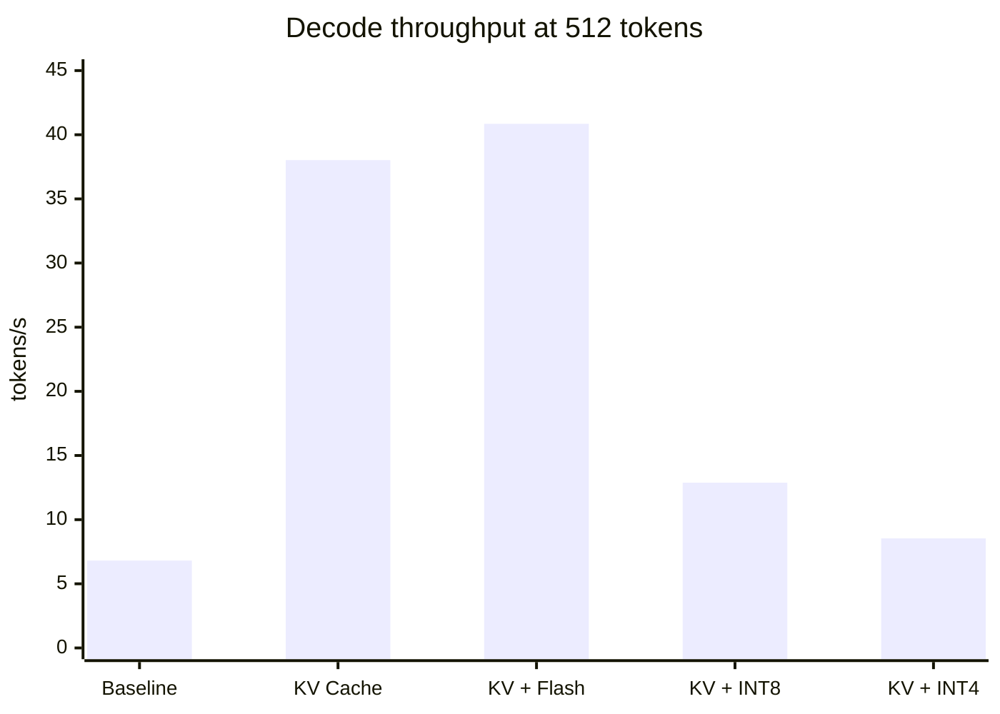
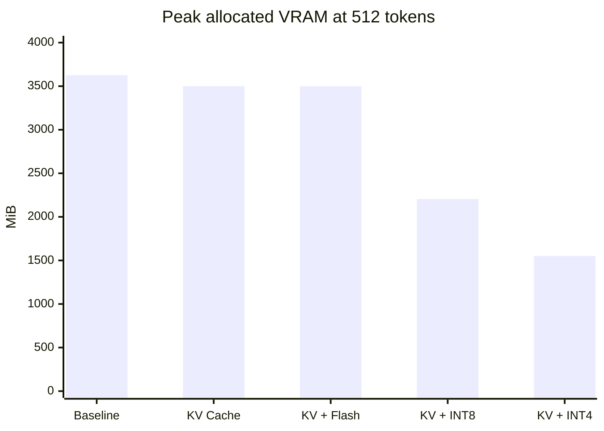
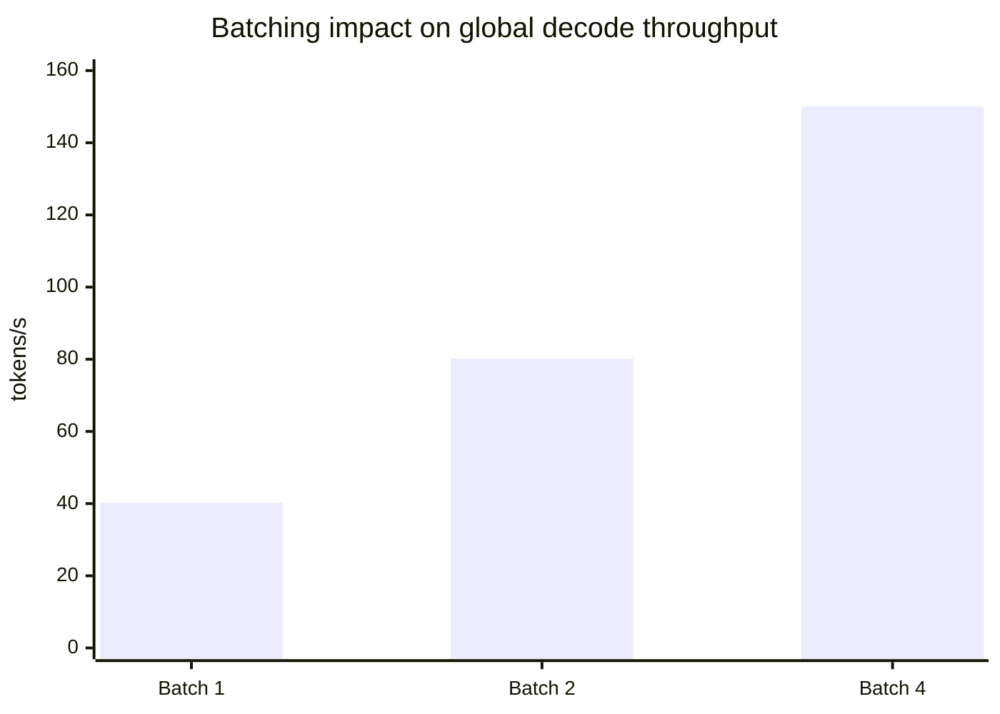

# LLM Inference Optimization

A custom LLM inference engine built in PyTorch, powered by Qwen3-1.7B, with a focus on optimizing inference speed, throughput, and GPU memory efficiency.

The project explores and benchmarks KV Caching, FlashAttention, INT8/INT4 Quantization, and Batched Inference, with a FastAPI backend and an interactive Streamlit interface for testing and visualizing performance.

## Results summary

On an RTX 4060 Laptop GPU (8 GiB), with a 512-token prompt and 64 generated tokens:

| Variant | Decode throughput | Peak allocated VRAM | Summary |
|---|---:|---:|---|
| BF16 baseline | 6.81 tok/s | 3627 MiB | Recomputes the full sequence for every token. |
| BF16 KV Cache | 38.02 tok/s | 3500 MiB | **5.58×** higher decode throughput. |
| KV Cache + FlashAttention | 40.85 tok/s | 3499 MiB | **6.00×** higher decode throughput. |
| KV Cache + INT8 | 12.88 tok/s | 2205 MiB | 39% less allocated VRAM, but slower. |
| KV Cache + INT4 | 8.54 tok/s | 1551 MiB | 57% less allocated VRAM, but slower. |


## Environment

- Ubuntu 24.04
- Python 3.12
- PyTorch `>=2.15.0` with CUDA
- NVIDIA RTX 4060 Laptop — 8 GiB VRAM
- Qwen/Qwen3-1.7B

## Installation

```bash
uv sync
```

The weights and tokenizer must be available in `checkpoint/`:

```text
checkpoint/
├── config.json
├── model-00001-of-00002.safetensors
├── model-00002-of-00002.safetensors
├── model.safetensors.index.json
└── tokenizer.json
```

Download them with:

```bash
uv run python scripts/download_model.py
```

Run the CPU test suite without loading the checkpoint or using the GPU:

```bash
uv run pytest
```

## Project structure

```text
src/llm_inference_optimization/
├── model/                    # Baseline Qwen3 architecture and checkpoint loading
├── inference/                # Baseline loading, generation, and shared helpers
├── optimizations/
│   ├── kv_cache/             # Dynamic KV Cache
│   ├── flash_attention/      # SDPA with forced FlashAttention backend
│   ├── quantization/         # Experimental INT8 and INT4 quantization
│   └── batching/             # KV Cache batched generation
├── benchmarking/             # GPU measurement scripts
└── api/                      # FastAPI application and inference service

benchmarks/results/
├── baseline/
├── advanced/
└── batching/

frontend/
├── app.py                    # Streamlit entry point and navigation
├── api.py                    # FastAPI client and HTTP error handling
├── config.py                 # Variants, labels, and shared UI settings
├── theme.py                  # Shared Streamlit styles
├── playground.py             # Live inference playground
├── dashboard.py              # Dashboard built from saved CSV results
└── README.md                 # Frontend-specific instructions

.streamlit/
└── config.toml               # Streamlit theme configuration
```

## Variants

### Baseline

The baseline recomputes a full forward pass for every generated token. It uses standard causal attention and BF16 weights.

### KV Cache

After prefill, each layer stores its keys and values. During decoding, only the new token is processed by the Transformer layers while previous keys and values are reused from the KV Cache.

### FlashAttention

The FlashAttention variant uses `torch.nn.functional.scaled_dot_product_attention` with the `FLASH_ATTENTION` backend forced.

### Quantification

`Linear` layers are quantized per output row:

- INT8: weights stored as `int8` with one scale per output.
- INT4: values packed into nibbles.

### Batching

Batched generation uses KV Cache, right padding, and one causal mask per example. Keys corresponding to padding are masked during prefill and decoding.

## Simple generation

```python
from llm_inference_optimization.inference.load_model import load_qwen_model
from llm_inference_optimization.inference.generation import generate

model, tokenizer = load_qwen_model()
text = generate(model, tokenizer, "Paris is the capital of", max_new_tokens=20)
print(text)
```

## Docker

The Docker image starts the FastAPI inference server. It does not include the Qwen checkpoint: mount the local `checkpoint/` directory at runtime to keep the image small.

GPU inference requires Docker with NVIDIA Container Toolkit configured on the host.

```bash
docker build -t llm-inference-optimization .

docker run --rm \
  --gpus all \
  -p 8000:8000 \
  -v "$(pwd)/checkpoint:/app/checkpoint:ro" \
  llm-inference-optimization
```

The server is then available at `http://localhost:8000`, with Swagger UI at `http://localhost:8000/docs`.

## FastAPI backend

Start the backend from the repository root:

```bash
uv run uvicorn llm_inference_optimization.api.main:app --reload
```

The API is available at `http://127.0.0.1:8000`.

- Swagger UI: `http://127.0.0.1:8000/docs`
- OpenAPI schema: `http://127.0.0.1:8000/openapi.json`
- Health check: `http://127.0.0.1:8000/health`

```bash
curl http://127.0.0.1:8000/health
```

```json
{"status": "ok"}
```

### `POST /generate`

The backend uses greedy decoding for one prompt. It applies the Qwen chat template with `enable_thinking=False` and returns only the generated assistant tokens.

```json
{
  "prompt": "Explain how KV caching speeds up LLM inference.",
  "max_new_tokens": 64,
  "variant": "kv_cache",
  "compare_to_baseline": true
}
```

| `variant` value | Implementation |
|---|---|
| `baseline` | BF16 full-sequence baseline |
| `kv_cache` | BF16 dynamic KV Cache |
| `kv_cache_flash_attention` | KV Cache + FlashAttention |
| `kv_cache_int8` | KV Cache + experimental INT8 layers |
| `kv_cache_int4` | KV Cache + experimental INT4 layers |

Successful responses contain this structure.
```json
{
  "variant": "kv_cache",
  "text": "...",
  "metrics": {
    "ttft_ms": 0.0,
    "mean_decode_step_latency_ms": 0.0,
    "decode_throughput_tokens_s": 0.0,
    "peak_allocated_vram_mib": 0.0
  },
  "baseline_metrics": null,
  "difference_vs_baseline": null
}
```

When `compare_to_baseline=true` for a non-baseline variant, the API sequentially measures the same request with the baseline. `baseline_metrics` then has the same four fields, while `difference_vs_baseline` contains:

- `decode_latency_speedup`: baseline mean decode latency / selected mean decode latency;
- `throughput_speedup`: selected throughput / baseline throughput;
- `vram_difference_mib`: selected peak allocated VRAM − baseline peak allocated VRAM.

The selected model is loaded and warmed up for every request. During a comparison it is released before the baseline is loaded, so two copies are not intentionally kept on the GPU.

## Streamlit frontend

The local Streamlit client has two pages:

- **Playground** sends one prompt to FastAPI and displays generated text, live metrics, and an optional baseline comparison.
- **Benchmarks** reads the saved CSV files and creates charts without using the GPU or rerunning benchmarks.

Start FastAPI first, then launch Streamlit in a second terminal:

```bash
uv run streamlit run frontend/app.py
```

Open `http://localhost:8501`.

Optional environment variables:


## Benchmarks

The advanced benchmark uses:

- 128-token and 512-token prompts;
- 64 generated tokens;
- 5 warmups;
- 10 repetitions;
- BF16 weights;
- `torch.cuda.synchronize()` around timed model forwards.

Models are loaded sequentially to stay within the 8 GiB VRAM limit.

### Metric definitions

- **TTFT (ms)** is the average time of the first timed model forward in each repetition. It excludes model loading, tokenization, position and mask construction, greedy `argmax`, and token concatenation.
- **Mean decode step latency (ms)** is the average timed model-forward latency across all 64 decoding steps, including the first step. It is not a TPOT metric that excludes the first token.
- **Decode throughput (tokens/s)** is calculated as `1000 / mean decode step latency`. It measures model-forward decoding throughput, not end-to-end application throughput.
- **Peak allocated VRAM (MiB)** is `torch.cuda.max_memory_allocated()`. It tracks memory allocated by PyTorch, not necessarily all GPU memory reported by `nvidia-smi`.

The API reports the same four concepts for a live request. Its model-forward timings exclude tokenization, mask construction, greedy selection, token concatenation, and model loading. API measurements include the first decode step in the mean; the first step is also reported separately as `ttft_ms`.

### Optimization comparison

Results are stored in `benchmarks/results/advanced/advanced.csv`.

| Variant | Prompt | TTFT | Mean decode step latency | Decode throughput | Peak allocated VRAM |
|---|---:|---:|---:|---:|---:|
| Baseline BF16 | 128 | 35.06 ms | 49.48 ms | 20.21 tok/s | 3403 MiB |
| KV Cache BF16 | 128 | 33.28 ms | 24.38 ms | 41.02 tok/s | 3343 MiB |
| KV + FlashAttention | 128 | 32.98 ms | 22.94 ms | 43.60 tok/s | 3343 MiB |
| KV + INT8 | 128 | 91.23 ms | 74.66 ms | 13.39 tok/s | 2048 MiB |
| KV + INT4 | 128 | 132.08 ms | 115.03 ms | 8.69 tok/s | 1391 MiB |
| Baseline BF16 | 512 | 119.39 ms | 146.83 ms | 6.81 tok/s | 3627 MiB |
| KV Cache BF16 | 512 | 124.09 ms | 26.30 ms | 38.02 tok/s | 3500 MiB |
| KV + FlashAttention | 512 | 112.91 ms | 24.48 ms | 40.85 tok/s | 3499 MiB |
| KV + INT8 | 512 | 184.23 ms | 77.65 ms | 12.88 tok/s | 2205 MiB |
| KV + INT4 | 512 | 224.94 ms | 117.10 ms | 8.54 tok/s | 1551 MiB |

#### Decode throughput at 512 tokens



#### Peak allocated VRAM at 512 tokens



At 512 tokens, KV Cache provides about **5.58×** higher decode throughput than the baseline. FlashAttention increases this gain to about **6.00×**. INT8 and INT4 substantially reduce allocated memory, but slow down this experimental implementation.

### Batching

Results are stored in `benchmarks/results/batching/batching.csv`.

| Batch size | TTFT | Mean decode step latency (ms) | Global decode throughput | Mean per-request decode throughput | Peak allocated VRAM |
|---:|---:|---:|---:|---:|---:|
| 1 | 33.50 ms | 24.81 ms | 40.31 tok/s | 40.31 tok/s | 3340 MiB |
| 2 | 62.52 ms | 24.93 ms | 80.21 tok/s | 40.10 tok/s | 3388 MiB |
| 4 | 112.47 ms | 26.65 ms | 150.08 tok/s | 37.52 tok/s | 3496 MiB |

Batch size 4 reaches **150.08 tok/s** of global decode throughput, about **3.72×** the throughput of batch size 1, with a moderate increase in allocated VRAM.

For batching, **mean decode step latency** is the execution time of one decode step for the full batch, not the total processing time of one request. **Global decode throughput** counts tokens from every request in the batch. **Mean per-request decode throughput** is global throughput divided by batch size.



### What the measurements show

| Technique | Decode latency | Global throughput | Allocated memory | Use case |
|---|---|---|---|---|
| Baseline | High for long prompts | Low | Reference | Understanding the initial cost. |
| KV Cache | Low during decoding | High | Stable | Standard autoregressive generation. |
| FlashAttention | Better prefill | Very high | Stable | Longer prompts. |
| INT8 / INT4 | Higher here | Lower here | Very low | Memory constraints and experimentation. |
| Batching | Increases with batch size | Very high | Slight increase | Multi-request serving. |

## Reproduce the measurements

```bash
# Baseline vs. KV Cache validation and comparison
uv run python -m llm_inference_optimization.benchmarking.compare

# BF16 baseline, KV Cache, FlashAttention, INT8, and INT4
uv run python -m llm_inference_optimization.benchmarking.advanced

# KV Cache batching: batch sizes 1, 2, and 4
uv run python -m llm_inference_optimization.benchmarking.batching
```

## Current limitations

- The KV Cache is dynamic and uses `torch.cat()` for every token; a preallocated cache would be more efficient.
- INT8 and INT4 are memory-compression experiments (not optimized quantized kernels).
- The FlashAttention benchmark requires the Flash backend to be actually available.
- The API accepts one prompt only. Batching is currently a Python implementation and an offline benchmark.
- Further performance gains would require custom Triton kernels, especially for quantized matrix multiplications that operate directly on INT8 or INT4 weights.

